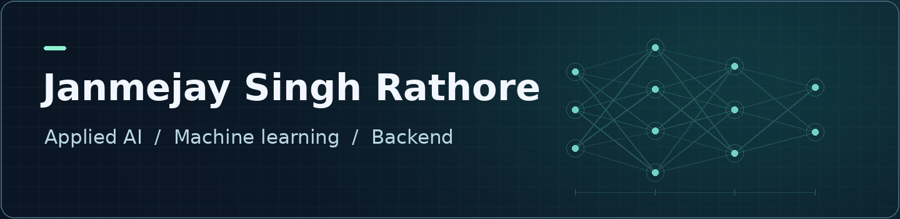

  

  <a href="#selected-projects"><strong>Selected projects</strong></a>
  &nbsp;·&nbsp;
  <a href="#technical-toolkit"><strong>Technical toolkit</strong></a>
  &nbsp;·&nbsp;
  <a href="https://linkedin.com/in/janmejay-singh-rathore"><strong>LinkedIn ↗</strong></a>

I’m an **Artificial Intelligence & Data Science student at DY Patil College of Engineering, Akurdi**. I build ML prototypes with documented evaluation, APIs, and usable interfaces. I also led the technical team for **Sambhav 3.0**, our college techfest.

**Open to AI/ML and software engineering internships and research collaborations.**

## Selected projects

### [Fraud Detection Dashboard ↗](https://github.com/JSR2406/Fraud-Detection-Dashboard-)

`Applied ML` · `Python` · `FastAPI` · `Streamlit`

A transaction-risk prototype with model training, a scoring API, a review dashboard, and local monitoring. The reproducible quick start uses synthetic data.

**Explore:** [Run the demo](https://github.com/JSR2406/Fraud-Detection-Dashboard-#2-quick-start--demo-mode-no-dataset-needed) · [Training code](https://github.com/JSR2406/Fraud-Detection-Dashboard-/blob/main/scripts/train.py) · [Tests](https://github.com/JSR2406/Fraud-Detection-Dashboard-/tree/main/tests)

### [IS Sarthi ↗](https://github.com/JSR2406/is-sarthi)

`Information retrieval` · `Python` · `FastAPI`

A procurement research prototype that retrieves and ranks candidate Indian Standards for a product specification. The repository documents the evaluation approach and the limitations of the source corpus.

**Explore:** [Evaluation protocol](https://github.com/JSR2406/is-sarthi/blob/main/docs/EVALUATION.md) · [Data sources](https://github.com/JSR2406/is-sarthi/blob/main/docs/DATA_SOURCES.md)

### [RoadGuard ↗](https://github.com/JSR2406/roadguard)

`Simulation` · `TypeScript` · `Node.js` · `SQLite`

A road-hazard pilot with a dashboard, persistent API, and simulated scenarios for reviewing pothole and animal-related hazard reports.

**Explore:** [Simulation](https://github.com/JSR2406/roadguard/tree/main/sim) · [Deployment guide](https://github.com/JSR2406/roadguard/blob/main/docs/deployment.md)

### More to explore

- **[Sambhav 3.0 ↗](https://github.com/JSR2406/SAMBHAV3.0)** · Led the technical team for the festival site, which includes a React event catalog, event pages, and a leaderboard. [Routing code](https://github.com/JSR2406/SAMBHAV3.0/blob/main/src/main.jsx)
- **[SkillBridge ↗](https://github.com/JSR2406/Skills-Bridge-)** · A Next.js and Firebase peer-learning platform with Q&A, AI tutoring, and mentor scheduling. [Architecture](https://github.com/JSR2406/Skills-Bridge-/blob/main/docs/ARCHITECTURE.md)

## Technical toolkit

| Area | Tools |
| --- | --- |
| Machine learning & data | Python · pandas · NumPy · scikit-learn |
| APIs & web | FastAPI · TypeScript · Node.js · React · Next.js |
| Data & development | SQL · SQLite · Firebase · Git · Docker |

[Connect on LinkedIn ↗](https://linkedin.com/in/janmejay-singh-rathore) · [Browse all repositories ↗](https://github.com/JSR2406?tab=repositories)
